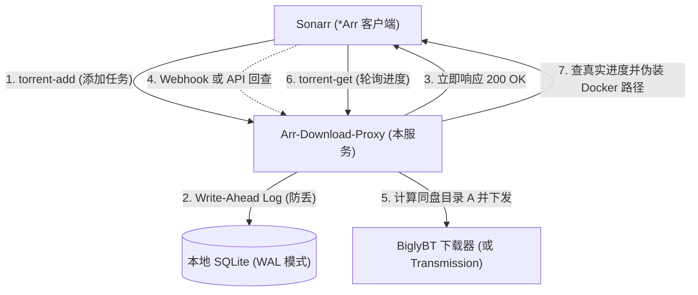
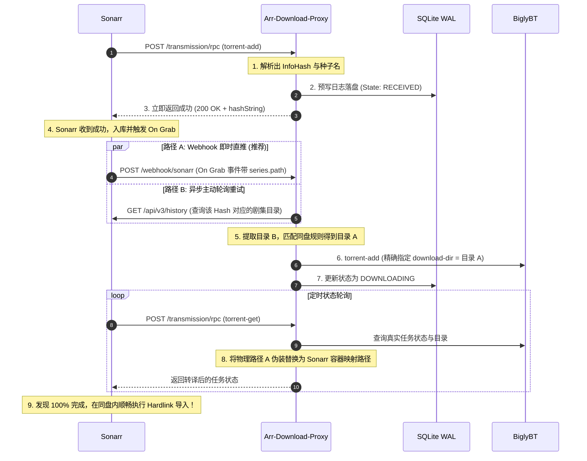

# Arr-Download-Proxy

[许可证：MIT](LICENSE)

> 专为 Sonarr / Radarr 与 BiglyBT 等下载器打造的智能路由中间件。解决**多盘分流**、**Docker 路径转译**与**硬链接 (Hardlink) 跨卷失败**的痛点。

---

## 一、 项目背景与痛点

在使用 Sonarr / Radarr（以下简称 *Arr）与 BiglyBT（或 Transmission/qBittorrent）构建自动化追剧系统时，常常面临以下核心矛盾：

1. **无法按剧集指定下载目录**：
   Sonarr 的 Download Client 设计上只支持配置一个全局固定目录（或单一 Category），无法根据剧集所存的物理磁盘动态下发下载目录。
2. **多盘环境下 Hardlink 失效**：
   Linux / Unix 的硬链接（Hardlink）必须处于**同一个物理文件系统 / 同一分区挂载点**。如果所有种子都统一下载到 Disk 1 的暂存目录，而某些剧集存放在 Disk 2，Sonarr 扫描导入时将无法 Hardlink，被迫退化为**全盘跨卷复制 (Copy)**，极度浪费磁盘空间与 IO。
3. **Docker 路径映射壁垒**：
   Sonarr 容器内的路径（如 `/downloads_disk1`）与宿主机真实物理路径（如 `/mnt/disk1/downloads`）不一致，常因映射配置稍有差池导致 Sonarr 报告找不到文件或导入失败。
4. **Sonarr 不适合魔改 Fork**：
   Sonarr 官方无动态插件机制，若直接 Fork 源码维护成本极高，每次上游合并、CI 与 Docker 构建都非常繁琐。

**Arr-Download-Proxy 采用“零侵入中间件”思路**：自身伪装成标准 Transmission RPC 接口，对上承接 Sonarr，对下精准调度 BiglyBT，在中转层完成元数据嗅探、多盘路径重写与 Docker 路径双向转译。

---

## 二、 架构设计与工作时序

### 1. 整体架构图



### 2. 时序陷阱与秒回闭环机制

在分析 Sonarr 源码（`DownloadService.cs`）时发现：**Sonarr 是在下载客户端返回成功之后，才将该次抓取（Grab）事件入库并发布通知**。如果中间件在收到请求时同步查询 Sonarr，会查不到该任务。

因此本服务实现了**秒回 + 异步编排机制**：



---

## 三、 Failsafe 容灾与幂等机制

为了保障系统“**意外断电/进程被杀不丢任务**”以及“**重复请求天然幂等**”，本服务采用如下设计：

1. **InfoHash 天然唯一主键**：
   无论是磁力链接还是种子二进制文件，提取出来的 40 位全小写十六进制 `InfoHash` 是唯一的。即使 Sonarr 因网络波动反复重发 `torrent-add`，数据库层天然幂等去重，已下载任务直接回传原有 Hash，不会重复启动。
2. **SQLite WAL 预写日志持久化**：
   通过纯 Go 实现的 `modernc.org/sqlite`，在无需 CGO 的前提下开启 `PRAGMA journal_mode = WAL` 与 `synchronous = NORMAL`。所有进入的种子在向 Sonarr 返回成功之前，原始文件与状态必须先安全落盘。
3. **启动自愈例程 (Crash Recovery)**：
   每次服务启动时，会自动扫描数据库中状态为 `RECEIVED` 或 `READY`（未成功交付下载器）的任务，直接从本地数据库保存的原始种子数据重放，向 BiglyBT 补发任务。

---

## 四、 快速上手与配置指南

- [Docker 构建与部署](docs/deployment.md)
- [GitHub Actions、GHCR 与 Release 发布](docs/releasing.md)

GHCR 镜像 `ghcr.io/chisaato/arr-download-proxy` 支持 Linux amd64/arm64：main 检查通过后更新 `:dev`；合法 `vSemVer` 标签发布对应版本与 `:latest`，**包括预发布版本**。GitHub Release 的预发布标记仍独立保留；需要固定版本时请使用具体版本标签。PR 仅检查，不发布。

### 1. 编译构建

本项目基于标准 Go 模块（Go 版本以 `go.mod` 为准，当前为 1.26.7），无 CGO 依赖：

```bash
cd arr-download-proxy

# 编译出单二进制文件
go build -o bin/arr-download-proxy ./cmd/server
```

### 2. 配置文件配置

复制配置模板：

```bash
cp config.example.yaml config.yaml
```

编辑 `config.yaml`：

```yaml
server:
  host: "0.0.0.0"
  port: 9091 # 代理服务端口

database:
  file_path: "data/proxy.db"

biglybt:
  # BiglyBT Transmission RPC 插件地址
  rpc_url: "http://127.0.0.1:9092/transmission/rpc"
  username: ""
  password: ""

sonarr:
  base_url: "http://127.0.0.1:8989"
  api_key: "你的_SONARR_API_KEY"
  timeout_seconds: 10

path_rules:
  # 兜底物理下载目录
  default_download_dir: "/mnt/disk1/downloads"

  # 多盘 Hardlink 规则匹配：
  # 根据剧集最终存放目录 (media_prefix)，匹配同一块物理磁盘下的下载目录 (download_dir)
  # 命中后保留 media_prefix 之后的全部相对后缀。例如 /mnt/disk1/media/tv/某剧 → /mnt/disk1/downloads/tv/某剧
  disk_mappings:
    - media_prefix: "/mnt/disk1/media/tv"
      download_dir: "/mnt/disk1/downloads/tv"
    - media_prefix: "/mnt/disk2/media/tv"
      download_dir: "/mnt/disk2/downloads/tv"

  # Docker 容器路径伪装转译：
  # 将宿主机物理目录动态翻译回 Sonarr 容器内部的挂载路径
  docker_mappings:
    - host_path: "/mnt/disk1/downloads/tv"
      container_path: "/downloads_disk1"
    - host_path: "/mnt/disk2/downloads/tv"
      container_path: "/downloads_disk2"
```

---

## 五、 Sonarr / BiglyBT 对接配置

### 1. BiglyBT 端设置
1. 打开 BiglyBT -> 工具 -> 插件 -> 安装插件向导（或配置已有插件）。
2. 确保已启用 **Transmission RPC** 插件（或 xmwebui 插件）。
3. 记录其监听端口（例如 `9092`），并在 `config.yaml` 的 `biglybt.rpc_url` 中填入。

### 2. Sonarr 端设置

#### 步骤 A：添加下载客户端 (Download Client)
1. 进入 Sonarr -> **Settings** -> **Download Clients** -> 点击 **+**。
2. 选择 **Transmission**。
3. 配置参数：
   - **Name**: `Arr-Proxy-BiglyBT`
   - **Host**: 运行本代理服务的 IP 地址（如果在同一宿主机填宿主机 IP）
   - **Port**: `9091`（即本代理监听的端口，**不要**直连 BiglyBT）
   - **Url Base**: `/transmission/`
   - **Username / Password**: 留空或填你在 `config.yaml` 中配置的账号密码
4. 点击 **Test**，显示绿色勾选后点击 **Save**。

   Sonarr 会先对 `/transmission/rpc` 发一个空的 GET，用来拿 `409` 和 `X-Transmission-Session-Id`。代理把这次握手转给 BiglyBT，只带上这次请求自己的 Basic 和已有的 session 头，不使用配置文件里的 BiglyBT 密码。随后的 POST 先用同样的入站 Basic 向 BiglyBT 做一次 `session-get`，通过后才在本地处理；`torrent-add` 仍被代理拦截。`?json=` 的 GET 走同一套校验和本地业务。`/health` 与 webhook 不走这套校验。

   回查剧集路径时请求 `/api/v3/history?eventType=1&includeSeries=true`。`eventType` 是整数枚举，`1` 表示 grabbed；再传字符串 `grabbed` 会得到 400。History 默认不含 `series`，不加 `includeSeries` 就没有路径。接口本身失败会保留完整的脱敏错误，不会改口说成没找到 hash。

   `torrent-get` 按 Sonarr 传来的 `fields`/`ids` 询问 BiglyBT，原样带回 `labels`、`files`、`isFinished` 等字段，只把 `downloadDir` 转成容器路径。`session-get` 同样只转译 `download-dir`，不再编造版本号。Vuze 的分类不是 labels：`Category=tv-sonarr` 且目录为空时，Sonarr 会把下载目录当成 `session-get` 的 `download-dir` 加上 `/tv-sonarr`，并丢掉不在该目录里的任务。本代理不会为了这个分类改落盘路径，也不会把 `isFinished=false` 改成 true。要验证导入，先把该下载客户端的分类清空。已失败或在 blocklist 里的任务不会自动重新跟踪。

#### 步骤 B：配置 Webhook（强烈推荐，实现 0 毫秒感知）
1. 进入 Sonarr -> **Settings** -> **Connect** -> 点击 **+**。
2. 选择 **Webhook**。
3. 配置参数：
   - **Name**: `Proxy-Grab-Notifier`
   - **Notification Triggers**: 只勾选 **On Grab**（抓取时通知）。
   - **URL**: `http://<代理服务IP>:9091/webhook/sonarr`
   - **Method**: `POST`
4. 保存即可。

---

## 六、 运行与后台守护

### 方式 1：直接运行

```bash
./bin/arr-download-proxy --config config.yaml
```

配置文件也可用短参数 `-c`。默认不输出每轮轮询明细；需要时加上 `--debug`。

```bash
./bin/arr-download-proxy -c config.yaml --debug
./bin/arr-download-proxy --help
```

### 方式 2：使用 systemd 守护进程

创建服务文件 `/etc/systemd/system/arr-download-proxy.service`：

```ini
[Unit]
Description=Arr Download Proxy for BiglyBT
After=network.target

[Service]
Type=simple
User=arr-download-proxy
WorkingDirectory=/opt/arr-download-proxy
ExecStart=/opt/arr-download-proxy/bin/arr-download-proxy --config /opt/arr-download-proxy/config.yaml
Restart=always
RestartSec=5

[Install]
WantedBy=multi-user.target
```

上面的用户与安装目录为示例，需先创建对应服务用户并按实际部署位置调整。

启用并启动：

```bash
sudo systemctl daemon-reload
sudo systemctl enable --now arr-download-proxy
```

---

## 七、 核心代码目录索引

- [cmd/server/main.go](cmd/server/main.go)：服务入口、崩溃自愈例程、优雅关机处理
- [internal/model/task.go](internal/model/task.go)：任务状态机与模型定义
- [internal/store/db.go](internal/store/db.go)：SQLite WAL 预写日志、任务落盘与幂等管理
- [internal/torrent/parser.go](internal/torrent/parser.go)：Torrent 二进制与 Magnet 的 40 位 InfoHash 解析
- [internal/pathmapper/mapper.go](internal/pathmapper/mapper.go)：同盘 Hardlink 路径匹配器与 Docker 路径伪装器
- [internal/sonarr/client.go](internal/sonarr/client.go)：Sonarr History API 轮询与 Webhook 解析
- [internal/downloader/bbt.go](internal/downloader/bbt.go)：BiglyBT Transmission RPC 协议封装
- [internal/server/server.go](internal/server/server.go)：RPC 拦截、秒回调度与 Docker 路径改写路由
